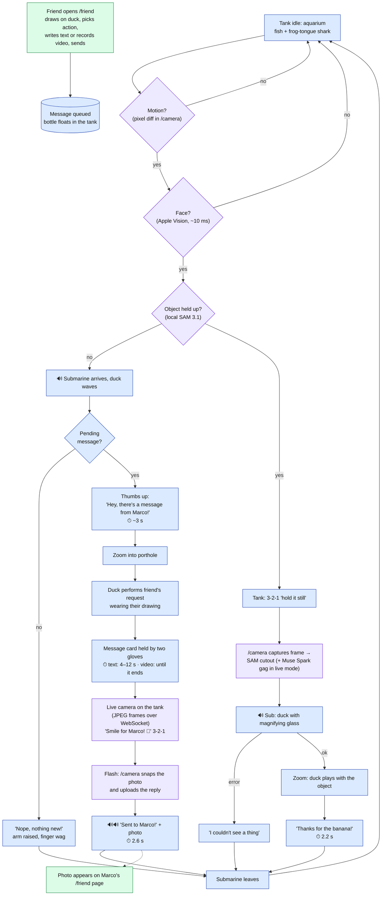

# Current interaction flow

How the tank (`/`, external OLED) and the camera page (`/camera`, Mac) behave **right now**. The tank needs **no input**: everything is driven by the webcam and timers.

Legend:
- 🟦 automatic
- 🟪 webcam / detection
- 🔊 quack sound (`web/public/quack.mp3`)
- ⏱ timer

## Notes

- **No touch, no keys needed** on the tank. Keys exist only for testing (see [KEYS.md](KEYS.md)).
- The reply is **mandatory** and is a **photo**. If `/camera` isn't connected, the tank shows "Open /camera on the Mac to reply" and the sub leaves.
- The message is marked as viewed right after the performance, so it won't come back.
- Show & Tell no longer offers gifting (it needed a choice); the gift endpoint still exists in the backend.
- **Sound:** browsers block audio until the page has been clicked once. If the tank shows "🔇 click anywhere to enable the quack", click it once with the mouse.
